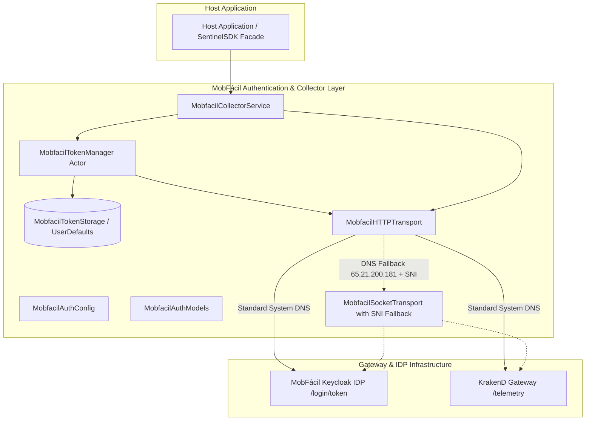

# Sentinel SDK: Architecture & Technical Design

## 1. High-Level Architecture

Sentinel SDK is designed around a modular, layered architecture that strictly decouples **Core Native Telemetry Engines** from **Platform Bridge Layers**.

```mermaid
graph TD
    subgraph Host Application
        RN[React Native App]
        FL[Flutter App]
        iOSNative[iOS Native App]
        AndNative[Android Native App]
    end

    subgraph Sentinel Bridge Layer
        RNBridge[Sentinel RN Bridge / TurboModule]
        FLPlugin[Sentinel Flutter Plugin / MethodChannel]
    end

    subgraph Native Binary SDK Core
        subgraph iOS Core [SentinelSDK.xcframework]
            iOS_Personal[PersonalDataValidator]
            iOS_Device[DeviceDataCollector]
            iOS_Location[LocationCollector]
            iOS_AppDetect[AppDetectionCollector]
            iOS_Security[PayloadSigner & CryptoKit]
        end
        subgraph Android Core [sentinel-core.aar]
            And_Personal[PersonalDataValidator]
            And_Device[DeviceDataCollector]
            And_Location[LocationCollector]
            And_AppDetect[AppDetectionCollector]
            And_Security[PayloadSigner & Keystore]
        end
    end

    RN --> RNBridge
    FL --> FLPlugin
    iOSNative --> iOS Core
    AndNative --> Android Core

    RNBridge --> iOS Core
    RNBridge --> Android Core
    FLPlugin --> iOS Core
    FLPlugin --> Android Core
```

---

## 2. Core Collectors & Validation Modules

### 2.1 Personal Data Validator (`PersonalDataValidator`)
- **Purpose**: Validates input customer parameters before transmission.
- **Rules**:
  - Full Name: Trims whitespace, validates minimum 2-token structure (`FirstName LastName`), Unicode-safe regex.
  - Document ID (e.g. CPF / Tax ID / SSN): Algorithmic check digit verification.
  - Phone Number: E.164 compliance and national format validation.
  - Email: RFC 5322 regex validation.

### 2.2 Device Telemetry Collector (`DeviceDataCollector`)
- **Attributes Collected**:
  - Model, brand, manufacturer, OS name and version.
  - Screen dimensions, locale, time zone, battery level/state.
  - Telephony details: Carrier name, MCC, MNC, ISO country code, SIM status, network type (5G/4G/WiFi).
  - Jailbreak / Root detection heuristics (suspicious files, symlinks, test-keys, su binary).

### 2.3 Precision Location Collector (`LocationCollector`)
- **iOS Implementation**: `CLLocationManager` requesting `kCLLocationAccuracyBest` with timeout fallback and mock-location heuristics.
- **Android Implementation**: High-accuracy `FusedLocationProviderClient` / `LocationManager` querying GPS and Network providers with `isFromMockProvider` detection.

### 2.4 Installed Application Detector (`AppDetectionCollector`)
- **Android (`<queries>`)**:
  - Statically declares targeted betting package names inside library `AndroidManifest.xml`.
  - Probes status via `packageManager.getPackageInfo(pkg, 0)` without needing `QUERY_ALL_PACKAGES`.
- **iOS (`canOpenURL`)**:
  - Probes configured schemes declared in host `Info.plist` under `LSApplicationQueriesSchemes`.
  - Flags apps that lack registered URL schemes as `unsupported_scheme_absent` to provide accurate diagnostic telemetry.

---

## 3. Cryptography & Security Layer (`PayloadSigner`)

1. **Payload Canonicalization**: Normalized JSON representation.
2. **SHA-256 Hashing**: Generates an authoritative digest of the payload.
3. **Cryptographic Signature**: Signs payload digest with client API credentials / session nonce using Apple `CryptoKit` on iOS and Android Keystore / HMAC-SHA256 on Android.

---

## 4. MobFácil Keycloak OAuth2 & KrakenD Gateway Pipeline

### 4.1 Component Layers



### 4.2 Lifecycle Flows

1. **Flow 1 (Company Authentication)**: Client credentials request to `POST /login/token` (`grant_type=client_credentials`, `client_id`, `client_secret`). Calculates `expiresAt = now + expiresIn` and persists token in storage.
2. **Flow 2 (Data Transmission)**: Serializes payload, injects `Authorization: Bearer <token>`, and transmits to KrakenD Gateway.
3. **Flow 2 Alt (401 Retry)**: If 401 Unauthorized is returned, invalidates cache, forces token refresh (`forceRefresh = true`), and retries transmission once.
4. **Flow 3 (Proactive Renewal & Concurrency Safety)**: When `remainingSeconds <= 60s`, kicks off background renewal. Concurrent callers share a coalesced in-flight `Task` lock avoiding duplicate requests.
5. **Flow 4 (Inadimplência)**: Maps `invalid_client` to `licenseBlocked` ("Licença bloqueada por inadimplência").
6. **Flow 5 (Secret Rotation)**: Maps `unauthorized_client` to `unauthorizedClient` ("Credenciais inválidas ou secret rotacionado").
7. **International DNS Fallback**: When standard DNS resolution of staging hostname `api.stg.mobfacil.com.br` fails on international carriers, falls back to IP `65.21.200.181` while preserving the original hostname for TLS SNI.

